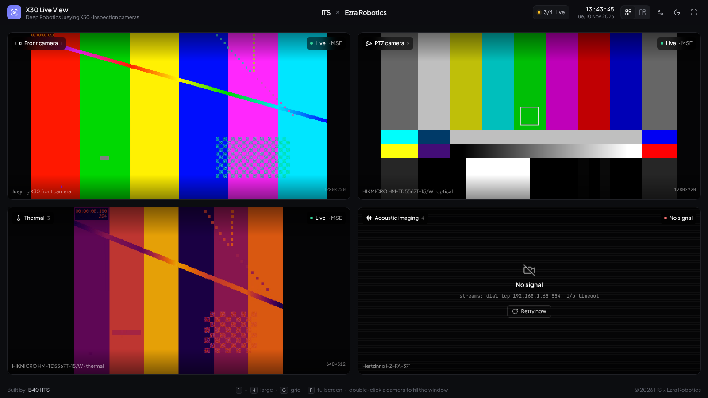

# X30 Live View

[](https://github.com/DarmawanWeb/SimpleRobotDashboard/actions/workflows/ci.yml)

A simple live camera display for the **Deep Robotics Jueying X30**: the front camera, the PTZ
camera, thermal and acoustic imaging, side by side. In the browser, on a TV, or as a desktop
app.

**ITS × Ezra Robotics** · Built by **B401 ITS**



- **Four cameras, nothing else**: live picture, whether it plays (Live / Connecting / No
  signal, with the reason), how it arrives (WebRTC or MSE) and its size.
- **Layouts**: a 2 × 2 grid, or one camera large with the other three beside it; any camera
  can fill the window (double-click).
- **Keeps itself running**: reconnects on its own after a dropped stream, a frozen picture or
  a camera that comes back later.
- **Light and dark**, the clock, fullscreen, keyboard shortcuts, phone and tablet layouts.
- **Desktop app** (Tauri) for macOS, Windows and Linux.

## How It Works

```
X30 cameras ──RTSP──▶ go2rtc ──WebRTC / MSE──▶ X30 Live View
front, PTZ,           (stream server,          (this repo: browser,
thermal, acoustic      port 1984)               TV or desktop app)
```

Browsers cannot play RTSP, so [go2rtc](https://github.com/AlexxIT/go2rtc) pulls the cameras
and serves them to the page with low latency: WebRTC when it can get through, MSE over a
WebSocket otherwise. The RTSP addresses live in go2rtc's config, not in the dashboard.

## Quick Start (Docker)

```bash
cp .env.example .env        # the cameras' RTSP addresses
docker compose up -d --build
```

Open `http://<this machine>:3000`. go2rtc's own page (each stream, codecs, errors) is on
`:1984`. go2rtc runs with host networking so WebRTC works on Linux; elsewhere the dashboard
falls back to MSE.

## Development

```bash
pnpm install
docker compose up -d go2rtc   # or run go2rtc yourself with docker/go2rtc.yaml
pnpm dev                      # http://localhost:3000
```

The dashboard finds go2rtc on the same host, port 1984. Point it elsewhere with
`NEXT_PUBLIC_GO2RTC_URL`, or in the app: **Settings (⚙) → Stream server** (saved per browser).

Opening `pnpm dev` from another device works for LAN IPs and `*.local` names; add other hosts
to `DEV_ORIGINS`.

| Script | |
|---|---|
| `pnpm dev` | dev server |
| `pnpm build` / `pnpm start` | standalone production server (the Docker image) |
| `pnpm lint` / `pnpm lint:fix` | Biome |
| `pnpm type-check` | TypeScript |
| `pnpm check` | lint, types and build (the pre-push hook) |
| `pnpm desktop` | the desktop app, live from the dev server |
| `pnpm desktop:build` | desktop installers for this machine |

Commits follow [Conventional Commits](https://www.conventionalcommits.org) (commitlint, run by
lefthook).

## Desktop App (Tauri)

Needs [Rust](https://rustup.rs) and the
[Tauri prerequisites](https://v2.tauri.app/start/prerequisites/) for your OS (Xcode command
line tools on macOS, WebView2 on Windows, WebKitGTK on Linux).

```bash
pnpm desktop          # a window with the dev server
pnpm desktop:build    # installers in src-tauri/target/release/bundle/
```

The app ships a static export of the dashboard (Tauri sets `TAURI_ENV_*`, `next.config.ts`
switches to `output: "export"`). It does not run go2rtc itself: on first start, open
**Settings → Stream server** and enter the go2rtc address on the robot's network, e.g.
`http://192.168.1.10:1984`, or bake one in with `NEXT_PUBLIC_GO2RTC_URL` when building.

Pushing a tag `v*` builds the installers for macOS (Apple silicon and Intel), Windows and
Linux on GitHub Actions and attaches them to a draft release (`.github/workflows/desktop.yml`).

## Configuration

| Where | What |
|---|---|
| `.env` (`FRONT_RTSP`, `PTZ_RTSP`, `THERMAL_RTSP`, `ACOUSTIC_RTSP`) | the cameras, read by go2rtc |
| `docker/go2rtc.yaml` | go2rtc: stream names, ports, transcoding |
| `NEXT_PUBLIC_GO2RTC_URL` | go2rtc as the browser reaches it (build time); empty: same host, port 1984 |
| `src/config/cameras.ts` | the four tiles: order, names, go2rtc stream names, devices |
| `src/config/brand.ts` | app, robot, partners and credits |
| `public/brand/` | the official logos (below) |

### Logos

Drop the official files into `public/brand/`, named after the slug; a `-dark` variant is used
on dark backgrounds. Until a file is there, the slot shows the name.

| Slug | Logo |
|---|---|
| `its` | Institut Teknologi Sepuluh Nopember |
| `ezra-robotics` | PT Ezra Robotics Teknologi |
| `b401` | B401 ITS (next to "Built by" in the footer) |

`its.svg`, `its-dark.svg`, `ezra-robotics.png`, … (svg, png, webp or jpg). The page is built
with whatever is there, so rebuild after adding them.

## Keyboard

| Key | |
|---|---|
| `1` – `4` | that camera large |
| `G` or `0` | back to the grid |
| `F` | fullscreen |
| `Esc` | leave a camera that fills the window |
| double-click | a camera fills the window |

## Troubleshooting

**A camera stays black or "No signal"** — open go2rtc's page (`:1984`) and the stream there:
it shows go2rtc's own error (wrong address, password, path). The tile shows the same reason.

**H.265 cameras** — WebRTC needs H.264 in most browsers, and MSE plays H.265 only where the
browser decodes it. Let go2rtc transcode that stream in `docker/go2rtc.yaml`:
`ptz: ffmpeg:${PTZ_RTSP}#video=h264#hardware`.

**Works on the LAN, not over HTTPS** — a page served over HTTPS may not open `ws://` or
`http://` to go2rtc. Serve go2rtc over HTTPS too (same reverse proxy or tunnel) and set its
address in the settings.

**WebRTC never connects** — it falls back to MSE on its own (a bit more latency). For WebRTC
outside host networking, publish port 8555 (TCP and UDP) and set `webrtc.candidates` in
`docker/go2rtc.yaml` to the host's LAN address.

## Project Structure

```
src/
├── app/                layout (fonts, theme), the page, icon
├── components/
│   ├── brand/          app mark, logos, ITS × Ezra Robotics lockup, credits
│   ├── camera/         grid, tile, status badge, no-signal state, player
│   ├── shell/          top bar, footer, layout switch, settings, shortcuts
│   ├── theme/          provider, light / dark toggle
│   └── ui/             small shared controls
├── config/             cameras, brand, build-time env
├── hooks/              fullscreen, theme, stream server
├── lib/
│   ├── go2rtc/         <camera-stream> element, server address, vendored VideoRTC
│   └── …               theme, logo discovery, utils
├── stores/             zustand: view, streams, settings, theme
└── types/
src-tauri/              the desktop app (Tauri 2)
docker/go2rtc.yaml      the stream server
```

## Credits

Built by **B401 ITS** for **ITS × Ezra Robotics**.

The player is go2rtc's `VideoRTC` (MIT, © Alexey Khit), vendored unchanged in
`src/lib/go2rtc/vendor/`.

## License

[Apache-2.0](LICENSE)
